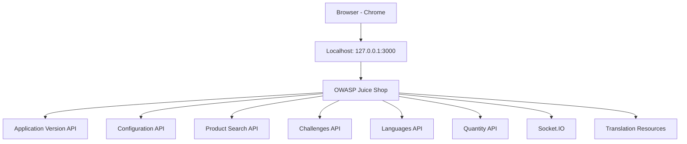

# Task 03 – Attack Surface Map

## 1. Target Overview

**Target:** OWASP Juice Shop  
**URL:** http://127.0.0.1:3000  
**Application Version:** 20.3.0  
**Runtime:** Node.js v24.21.0  
**Host Port Binding:** 127.0.0.1:3000

## 2. Attack Surface Diagram

## 3. Observed Attack Surface

| Component | Endpoint | Observation |
|---|---|---|
| Application Version | /rest/admin/application-version | Version-related response |
| Application Configuration | /rest/admin/application-configuration | Configuration information |
| Product Search | /rest/products/search?q=apple | User-controlled search parameter |
| Challenges | /api/Challenges/ | Challenge metadata |
| Languages | /rest/languages | Language information |
| Quantity | /api/Quantitys/ | Quantity-related information |
| Real-time Communication | /socket.io/ | Socket.IO communication |
| Translation Resources | /assets/i18n/en.json | Client-side translation data |

## 4. Preliminary Risk Areas

1. **Information Exposure:** Review whether configuration and version information reveal unnecessary implementation details.
2. **Input Handling:** Review validation and handling of the product search parameter.
3. **Access Control:** Review whether sensitive API data is restricted to authorized users.
4. **Real-time Communication:** Review authentication and authorization of Socket.IO events.
5. **Client-side Resources:** Review whether client-side resources expose information that should remain private.

These are preliminary hypotheses, not confirmed vulnerabilities.

## 5. Scope and Safety

- Reconnaissance was performed only against my own local OWASP Juice Shop instance.
- The application host port is bound to 127.0.0.1.
- The running container uses Docker's default bridge network, not the separate internal Docker network.
- No third-party targets were accessed.
- No destructive testing was performed.

## 6. Conclusion

The attack surface map identifies the browser-facing application and the API routes observed during passive reconnaissance. These findings establish a baseline for future authorized security testing.
